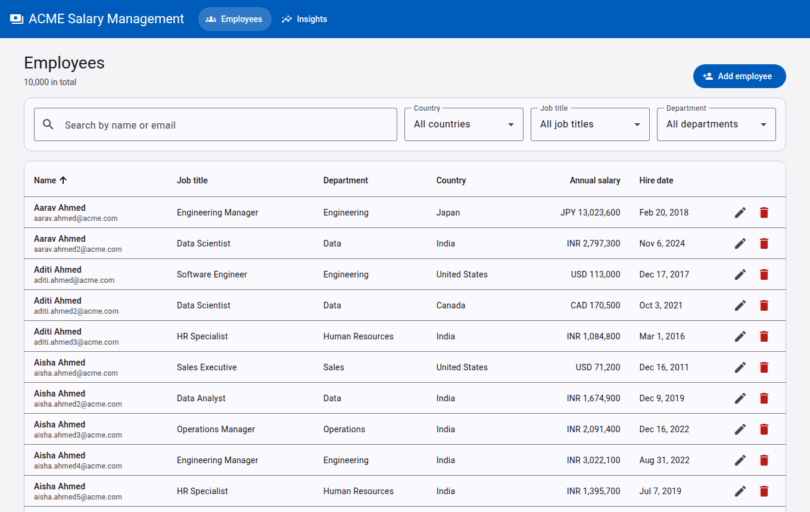
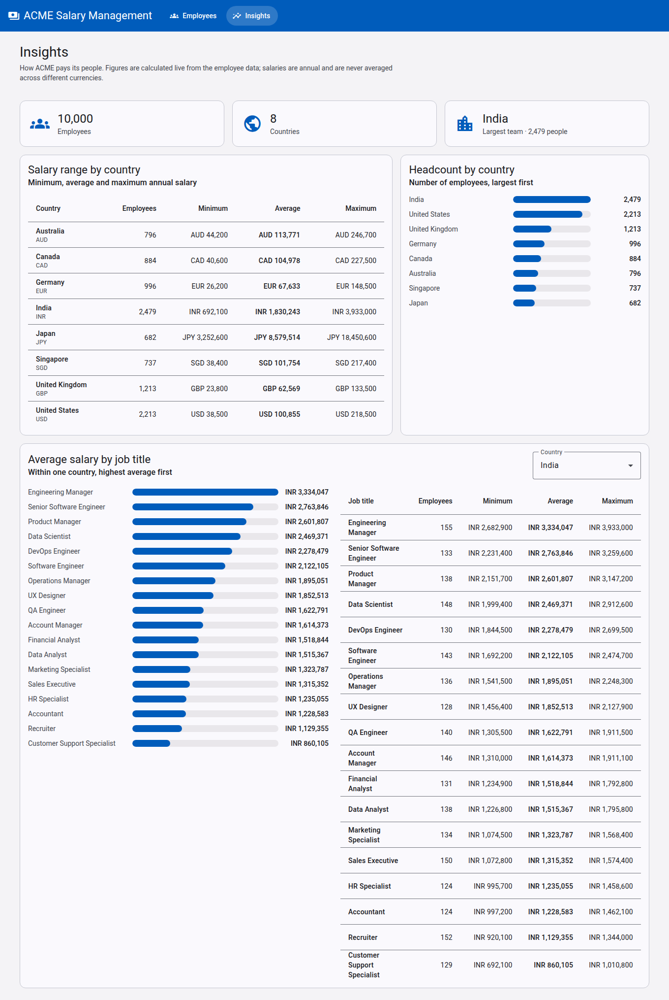

# ACME Salary Management

A web application that lets ACME's **HR Manager** manage salary data for **10,000 employees
in 8 countries** — replacing Excel — and answer questions about how the organisation pays
people:

- What are the minimum, maximum and average salaries in each country?
- What is the average salary for a job title in a country?
- How many employees work in each country?

**Backend:** Java 17 · Spring Boot 3.5 · Spring Data JPA · Bean Validation · Flyway · H2 (file)
**Frontend:** Angular 20 · Angular Material 20 · standalone components · signals · strict TypeScript
**Tests:** JUnit 5 · Mockito · `@DataJpaTest` / `@WebMvcTest` · Jasmine/Karma





## Features

- **Employee list** — server-side pagination (10–100 rows per page), search by name or email,
  filters for country / job title / department, sorting by name, salary or hire date.
- **Add and edit** in a dialog with validation (required fields, valid email, salary > 0, hire
  date not in the future, ISO currency, unique email); server errors appear next to the field.
- **Delete** with a confirmation dialog; snackbar feedback for every change.
- **Insights** — salary range per country, average salary per job title in a country,
  headcount per country; computed by SQL aggregates and never mixed across currencies.
- Loading, empty and error states everywhere; works on phone-sized screens.
- **Seed** of 10,000 realistic, repeatable employees on first start.

What is deliberately *not* built (login, payroll, currency conversion, salary history,
Excel import) and why: [docs/REQUIREMENTS.md](docs/REQUIREMENTS.md).

## Prerequisites

| Tool | Version | Check with |
|---|---|---|
| Java (JDK) | 17 or newer | `java -version` |
| Node.js | 20.19+, 22.12+ or 24+ | `node -v` |
| npm | comes with Node.js | `npm -v` |
| Chrome or Chromium | any recent | only needed for the frontend tests |

Maven does **not** need to be installed: the backend includes the Maven wrapper (`./mvnw`).
Ports **8080** (API) and **4200** (UI) must be free.

## Run it locally

Open two terminals in the project root.

**Terminal 1 — backend**

```bash
cd backend
./mvnw spring-boot:run
```

On Windows use `mvnw.cmd spring-boot:run`. The first start downloads dependencies, creates
the database in `backend/data/` and seeds it. Wait for this line in the log:

```
Seeded 10000 employees in … ms
```

(On later starts you will see `Skipping seed: database already has 10000 employees`.)
The API is now available at <http://localhost:8080/api/employees>.

**Terminal 2 — frontend**

```bash
cd frontend
npm ci
npm start
```

Open <http://localhost:4200>. The Angular dev server forwards `/api` calls to the backend
(`frontend/proxy.conf.json`), so nothing else needs to be configured.

To stop, press `Ctrl+C` in both terminals.

## How the seed works

- `EmployeeSeeder` runs once after the backend starts. It only seeds when the `employee`
  table is **empty**, so your changes survive restarts.
- `EmployeeDataGenerator` creates employees from a **fixed random seed (42)**, so everyone gets
  the same data: 8 countries (each with its own currency and realistic local pay levels),
  18 job titles in 10 departments, hire dates over the last 15 years, unique emails.
- All 10,000 rows are inserted in one transaction with batched inserts (2–3 seconds).
- Settings are in `backend/src/main/resources/application.properties`
  (`app.seed.enabled`, `app.seed.employee-count`, `app.seed.random-seed`).
- **Start over with fresh data:** stop the backend, delete the `backend/data/` folder, start it
  again.

## Look inside the database

There is nothing to install: H2 is an embedded database that runs inside the backend, and
Flyway creates the schema (`V1__create_employee_table.sql`) on the first start.

1. Start the backend, then open <http://localhost:8080/h2-console>.
2. Change **JDBC URL** to `jdbc:h2:file:./data/salarydb` (the default `jdbc:h2:~/test` is a
   different, empty database). User name `sa`, password empty. Click **Connect**.
3. Run SQL, for example:

```sql
SELECT COUNT(*) FROM employee;
SELECT country, currency, MIN(salary), AVG(salary), MAX(salary), COUNT(*)
FROM employee GROUP BY country, currency ORDER BY country;
SELECT * FROM flyway_schema_history;      -- which migrations have run
```

The console is for local development only: it is reachable from the same machine and would be
switched off (`spring.h2.console.enabled=false`) in any shared environment.

## Run the tests

```bash
cd backend
./mvnw test              # 58 tests: unit, repository (real SQL on in-memory H2), web layer
```

```bash
cd frontend
npm test                 # 20 tests in Chrome (watch mode)
npm run test:ci          # same, single run in headless Chrome
```

If Chrome is installed somewhere unusual, point to it first, e.g.
`export CHROME_BIN=/path/to/chrome`. Backend tests never touch `backend/data/`.

## API

Base URL `http://localhost:8080/api`. Errors use the RFC 9457 *problem details* format, with
an `errors` map of `field → message` for validation problems.

| Method | Path | Result |
|---|---|---|
| `GET` | `/employees?search=&country=&jobTitle=&department=&page=0&size=20&sortBy=NAME&direction=ASC` | 200, one page (`sortBy`: `NAME`, `SALARY`, `HIRE_DATE`; `size` 1–100) |
| `GET` | `/employees/filter-options` | 200, distinct countries / job titles / departments |
| `GET` | `/employees/{id}` | 200, or 404 |
| `POST` | `/employees` | 201 + `Location`, 400, or 409 (email taken) |
| `PUT` | `/employees/{id}` | 200, 400, 404, or 409 |
| `DELETE` | `/employees/{id}` | 204, or 404 |
| `GET` | `/insights/salary-by-country` | 200, min / max / average / count per country and currency |
| `GET` | `/insights/salary-by-job-title?country=India` | 200, per job title in that country; 400 if `country` is blank |
| `GET` | `/insights/headcount-by-country` | 200, employees per country |

Examples:

```bash
curl "http://localhost:8080/api/employees?country=India&sortBy=SALARY&direction=DESC&size=5"
curl "http://localhost:8080/api/insights/salary-by-country"
curl -i -X POST http://localhost:8080/api/employees -H "Content-Type: application/json" -d '{
  "firstName": "Asha", "lastName": "Rao", "email": "asha.rao.new@acme.com",
  "jobTitle": "Software Engineer", "department": "Engineering", "country": "India",
  "salary": 1500000, "currency": "INR", "hireDate": "2022-04-01"}'
```

## Project structure

```
.
├── README.md                 you are here
├── docs/
│   ├── REQUIREMENTS.md       one-page requirements: scope and what is left out
│   ├── ARCHITECTURE.md       diagrams, layers, request flows
│   ├── DESIGN-DECISIONS.md   every significant decision and its trade-off
│   ├── PERFORMANCE.md        how 10,000 employees stay fast (measured)
│   └── AI-PROMPTS.md         how AI was used, the prompt, what verification caught
├── backend/                  Spring Boot API         → backend/README.md
│   └── src/main/java/com/acme/salary/
│       controller/ service/ repository/ entity/ dto/ mapper/
│       exception/ validation/ seed/ config/       (each has its own README.md)
└── frontend/                 Angular app             → frontend/README.md
    └── src/app/
        employees/ insights/ shared/                  (each has its own README.md)
```

## How I used AI

I built this with **Claude Code** (Anthropic's agentic coding tool). I gave it one detailed
prompt that fixed the tech stack, the quality bar (no Lombok or "magic" I could not explain,
one purpose per class, statistics in SQL, server-side pagination) and the order of work, and
required it to commit after every layer or feature and to prove every step by running tests,
the app and a real browser.

The main prompts were:

1. *"what they are saying can u help me"* — with the assessment brief pasted, to understand
   the deliverables and agree on scope.
2. The build prompt: context, hard constraints, fixed tech stack, data model, API contract,
   scalability rules, a 7-step workflow with a commit after each step, documentation list,
   quality bar and a final verification checklist.

The full build prompt, the constraints and the problems that verification caught (and how
they were fixed) are in [docs/AI-PROMPTS.md](docs/AI-PROMPTS.md).

## Troubleshooting

- **`Port 8080 was already in use`** — another process uses the port; stop it or start the
  backend with `./mvnw spring-boot:run -Dspring-boot.run.arguments=--server.port=8081` and
  change the target in `frontend/proxy.conf.json` to match.
- **The list shows "Cannot reach the server"** — the backend is not running (start terminal 1).
- **Frontend tests: `No usable sandbox`** on Linux — use `npm run test:ci`, which starts
  headless Chrome with `--no-sandbox`.
