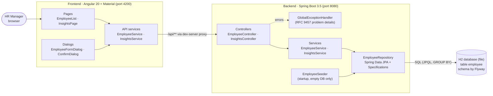
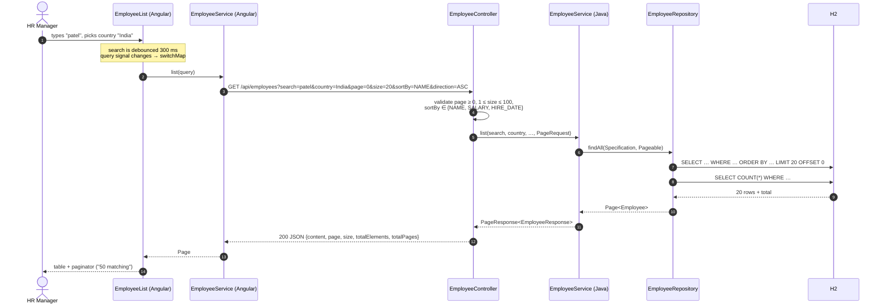
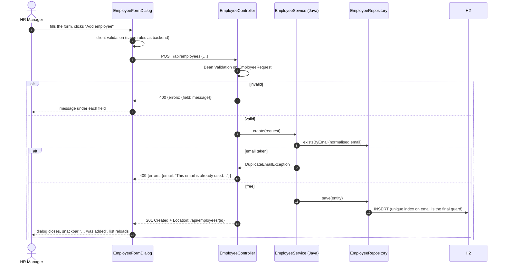
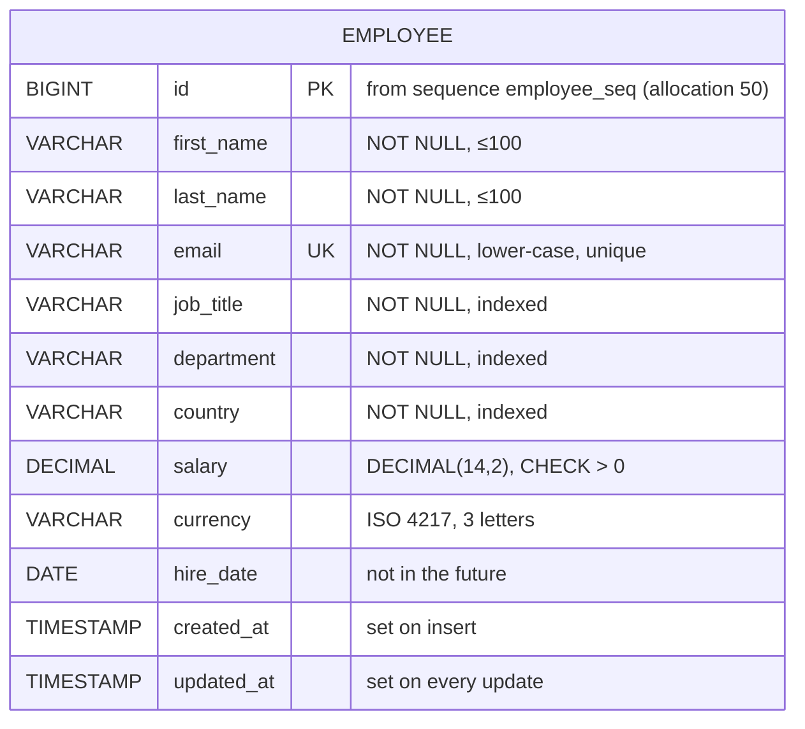

# Architecture

## Overview

A classic three-tier web application: an Angular single-page app talks JSON over HTTP to a
Spring Boot REST API, which stores data in an H2 relational database (file mode).



## Backend layers

Each layer has one job and only talks to the layer below it.

| Layer (package) | Responsibility | Knows about |
|---|---|---|
| `controller` | HTTP: URLs, query parameters, status codes (201, 204), request validation trigger (`@Valid`) | services, DTOs |
| `exception` | Turns exceptions into JSON error responses (404, 409, 400 with field messages) | domain exceptions |
| `service` | Business rules: unique email, not-found handling, rounding averages, transactions | repository, mapper, DTOs |
| `mapper` | Converts DTO ⇄ entity and normalises input (trim, lower-case email, upper-case currency) | DTOs, entity |
| `repository` | Database access: CRUD, paged search, aggregate SQL queries | entity |
| `entity` | The `Employee` table mapping | — |
| `dto` | The JSON contract of the API (Java records) and request validation rules | — |
| `validation` | Custom `@ValidCurrency` constraint (ISO 4217) | — |
| `seed` + `config` | Demo data generation and its settings | repository, entity |

Every package has its own `README.md` describing each class.

## Request flow: listing employees



## Request flow: creating an employee



## Request flow: insights

`GET /api/insights/salary-by-country` → `InsightsController` → `InsightsService` →
`EmployeeRepository.salaryStatsByCountry()`, which runs a single
`SELECT country, currency, MIN, MAX, AVG, COUNT … GROUP BY country, currency`.
The database returns 8 small rows; Java only rounds the averages and renames fields.
No employee entity is loaded for any insight.

## Frontend structure

```
src/app
├── app.ts / app.html        shell: toolbar navigation + <router-outlet>
├── app.routes.ts            /employees, /insights (lazy-loaded pages)
├── employees/               list page, add/edit dialog, model, API service
├── insights/                dashboard page, model, API service
└── shared/                  confirm dialog, bar chart, notifications, error/date helpers
```

- **State**: each page keeps its state in Angular **signals** (`query`, `page`, `loading`,
  `error`). Templates read signals, so the view updates automatically.
- **Async**: HTTP calls are RxJS observables. The list turns its `query` signal into an
  observable and uses `switchMap`, so a newer query cancels an older in-flight request.
- **Routing**: both pages are lazy-loaded (`loadComponent`), so each page's code is
  downloaded only when it is opened.
- **API access**: only the two `*.service.ts` files know URLs. Components never call
  `HttpClient` directly.
- **Dev proxy**: `proxy.conf.json` forwards `/api` from `localhost:4200` to
  `localhost:8080`, so the browser sees one origin and no CORS configuration is needed.

## Data model



One table is enough for the scope (see [REQUIREMENTS.md](REQUIREMENTS.md)). Salary history
would add a second, append-only `salary_change` table.
